<!--
  SETUP
  1. Public repo named exactly like your GitHub username.
  2. Save this file in it as README.md.
  3. Add header.svg and terminal.svg inside a folder called "assets" in that repo.
  4. Replace YOUR-USERNAME and the placeholder links (your-portfolio.com, your-handle, you@example.com).
  5. Optional snake: add snake.yml as .github/workflows/snake.yml and run it once from the Actions tab.
-->

<div align="center">

<!-- HERO: custom animated SVG (assets/header.svg) -->


<!-- TYPING TEXT: lines after "lines=" are separated by ; and spaces are + -->
<a href="https://your-portfolio.com">
  
</a>

<br/>


</div>

<h3 align="center">About</h3>

<!-- ANIMATED TERMINAL: custom SVG (assets/terminal.svg), types out on a loop -->
<div align="center">
  
</div>

```js
const me = {
  name: "佐藤 大喜",
  role: "Web creator",
  currentlyBuilding: "my portfolio site",
  openFor: ["Commissions", "Collabs", "Coffee chats"],
  motto: "Clean code, sharp design.",
};
```

<h3 align="center">Toolbox</h3>

<!-- LANGUAGE & TOOL SYMBOLS: swap the ids after "i=" (full list: https://skillicons.dev) -->
<div align="center">
  <sub>Languages</sub><br/>
  <br/><br/>
  <sub>Frameworks</sub><br/>
  <br/><br/>
  <sub>Tools</sub><br/>
  
</div>

<h3 align="center">Stats</h3>

<div align="center">
  
  
  <br/>
  
</div>

<h3 align="center">Contributions</h3>

<!-- SNAKE: needs snake.yml (see SETUP) -->
<div align="center">
  <picture>
    <source media="(prefers-color-scheme: dark)" srcset="https://raw.githubusercontent.com/YOUR-USERNAME/YOUR-USERNAME/output/github-snake-dark.svg" />
    <source media="(prefers-color-scheme: light)" srcset="https://raw.githubusercontent.com/YOUR-USERNAME/YOUR-USERNAME/output/github-snake.svg" />
    
  </picture>
</div>

<h3 align="center">Connect</h3>

<div align="center">
  <a href="https://your-portfolio.com"></a>
  <a href="https://instagram.com/your-handle"></a>
  <a href="mailto:you@example.com"></a>
</div>

<br/>


