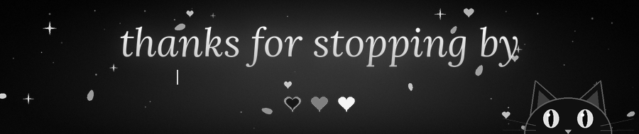

<a id="top"></a>

<!--
  Upload header.gif, footer.gif and divider.gif into an /assets folder in this repo.
  Want your own header GIF? Replace assets/header.gif (or change the src below).
-->

<div align="center">
  
</div>

<p align="center">
  <a href="#me">Me</a> &nbsp;•&nbsp;
  <a href="#hearts">Favorites</a> &nbsp;•&nbsp;
  <a href="#what-i-do">What I Do</a> &nbsp;•&nbsp;
  <a href="#project">Project</a> &nbsp;•&nbsp;
  <a href="#repos">Repos</a> &nbsp;•&nbsp;
  <a href="#tools">Tools</a> &nbsp;•&nbsp;
  <a href="#stats">Stats</a> &nbsp;•&nbsp;
  <a href="#contact">Contact</a>
</p>

```text
aru@meow:~$ cat about.txt

 /\_/\    hi, i'm aruki
( o.o )   romance anime fan · coder · photographer · stream helper
 > ^ <    status: wondering while coding...

aru@meow:~$ ls ~/repos
arumeow.online/   ImArukiya.github.io/   AkuHoitaa/   Aino/   ...

aru@meow:~$ echo $LANGUAGES
HTML · CSS · JavaScript · Markdown · C# · C++
```

<p align="center"></p>

<a id="me"></a>

## 🖤 Me

> ૮꒰ ˶ᵔ ᵕ ᵔ˶ ꒱ა I’m Aruki — a romance-anime-loving creator who codes, edits and shoots photos, and helps keep my friends’ Twitch streams running smoothly behind the scenes. I like making things that are cute, clean and actually work.

- 🏷️ **Known as:** Aru / Aruki ♡
- 💭 **Status:** wondering while coding
- 🤍 **Vibe:** romantic at heart — you can tell from my taste in anime
- 🖼️ **Fun fact:** my profile picture changes faster than you can blink
- 🔗 **Home on the web:** [arumeow.online](https://arumeow.online/)

<p align="center"></p>

<a id="hearts"></a>

## 🖤 Heart List

<div align="center">
<table>
  <tr>
    <td width="33%" valign="top" align="center">
      🎞️ <b>Anime</b><br /><br />
      <i>Blue Box</i><br />
      <i>Tonikawa</i><br />
      <i>My Dress-Up Darling</i>
    </td>
    <td width="33%" valign="top" align="center">
      🤍 <b>Favorite characters</b><br /><br />
      Mahiru<br />
      Chii<br />
      Waguri<br />
      <sub>+ a soft spot for tsunderes</sub>
    </td>
    <td width="33%" valign="top" align="center">
      🎧 <b>On repeat</b><br /><br />
      <i>I Wanna Be Yours</i><br />
      Arctic Monkeys
    </td>
  </tr>
</table>
<br />
<a href="https://anilist.co/user/RomGuyAruki"></a>
</div>

<p align="center"></p>

<a id="what-i-do"></a>

## 🖤 What I Do

<div align="center">
<table>
  <tr>
    <td width="33%" valign="top">
      🎞️ <b>Romance Anime</b><br /><br />
      I watch a <i>lot</i> of romance anime — hopeless romantic, zero regrets.<br /><br />
      <a href="https://anilist.co/user/RomGuyAruki">→ My List on AniList</a>
    </td>
    <td width="33%" valign="top">
      🎮 <b>Gaming</b><br /><br />
      I play games whenever I get the chance — always up for a good session.<br /><br />
      <a href="https://steamcommunity.com/id/arudesu">→ Find me on Steam</a>
    </td>
    <td width="33%" valign="top">
      💻 <b>Coding</b><br /><br />
      I code many things, and I love when they look as good as they work.<br /><br />
      <a href="https://arumeow.online/">→ See what I built</a>
    </td>
  </tr>
  <tr>
    <td valign="top">
      🎚️ <b>Photo Editing</b><br /><br />
      I edit photos a lot — turning good shots into great ones.
    </td>
    <td valign="top">
      📷 <b>Photography</b><br /><br />
      I photograph a lot — always chasing the next good frame.
    </td>
    <td valign="top">
      🎙️ <b>Twitch Mod &amp; Setup</b><br /><br />
      I moderate and set things up for my friends’ streams so they can just have fun.<br /><br />
      <a href="https://www.twitch.tv/romguyaruki">→ My Twitch</a>
    </td>
  </tr>
</table>
</div>

<!--
  📷 Want a mini photo gallery? Upload 3 of your favorite shots to /assets,
  then remove this comment wrapper:

  <p align="center">
    
    
    
  </p>
-->

<p align="center"></p>

<a id="project"></a>

## 🩶 Featured Project

<div align="center">
  <a href="https://arumeow.online/">
    
  </a>
</div>

<br />

**[arumeow.online](https://arumeow.online/)** is my self-coded 3D socials page — one big `index.html` (~3k lines) of HTML, CSS and JavaScript.

| Feature | Details |
| --- | --- |
| 🪟 **3D glass card** | Tilts toward the cursor with a moving glare and rim light |
| 🚪 **Click-to-enter intro** | A loading screen with a tick-style progress ring |
| 💬 **Live Discord presence** | My status and what I’m playing or listening to, via the Lanyard API |
| 📊 **Rating pulse** | AniList score, score spread, watch state, top genres and what airs next |
| 🎞️ **3D anime carousel** | Drag, scroll or use the arrow keys through my AniList collection |
| 🎵 **Ambient player** | Background video with seek and volume controls |
| 🌗 **Polish** | Light/dark theme, keyboard shortcuts, reduced-motion support and an automatic “lite mode” for slower devices |

<p align="center"></p>

<a id="repos"></a>

## 🩶 Repositories

<div align="center">
<table>
  <tr>
    <th align="left">Repo</th>
    <th align="left">What it is</th>
    <th align="left">Language</th>
  </tr>
  <tr>
    <td><a href="https://github.com/ImArukiya/arumeow.online"><b>arumeow.online</b></a></td>
    <td>My self-coded 3D socials page</td>
    <td>
      
      
    </td>
  </tr>
  <tr>
    <td><a href="https://github.com/ImArukiya/ImArukiya.github.io"><b>ImArukiya.github.io</b></a></td>
    <td>My GitHub Pages site</td>
    <td>
      
      
    </td>
  </tr>
  <tr>
    <td><a href="https://github.com/ImArukiya/AkuHoitaa"><b>AkuHoitaa</b></a></td>
    <td>A little web project with a music folder</td>
    <td>
      
      
    </td>
  </tr>
  <tr>
    <td><a href="https://github.com/ImArukiya/Aino"><b>Aino</b></a></td>
    <td>Aino.AI — an assistant-AI concept that helps older people keep up with daily health routines (medication reminders, health task alerts, a simple interface)</td>
    <td>
      
      
    </td>
  </tr>
</table>
<sub>…and more in my <a href="https://github.com/ImArukiya?tab=repositories">repositories tab</a>.</sub>
</div>

<p align="center"></p>

<a id="tools"></a>

## 🩶 Languages & Tools

<div align="center">

<sub><b>LANGUAGES · FOUND IN MY REPOS</b></sub>
<br />


<br />

<sub><b>ALSO IN MY TOOLBOX</b></sub>
<br />


<br />

<sub><b>DEV TOOLS</b></sub>
<br />


<br />

<sub><b>CREATIVE TOOLS</b></sub>
<br />


</div>

<!--
  Add more badges by copying one line above and swapping NAME / HEX / SLUG.
  Keep the hex between 000000 (black) and ffffff (white) to stay on theme:
  https://img.shields.io/badge/NAME-HEX?style=for-the-badge&logo=SLUG&logoColor=white
  (use logoColor=black on light grays)
-->

<p align="center"></p>

<a id="stats"></a>

## 🤍 Stats

<div align="center">
  
  
  <br />
  
</div>

<p align="center"></p>

<a id="contact"></a>

## 🤍 Say Hi

Always happy to chat about code, stream setups, photography — and, obviously, anime.

<p align="center">
  <a href="https://www.twitch.tv/romguyaruki"></a>
  <a href="https://www.youtube.com/@RomGuyAruki"></a>
  <a href="https://www.tiktok.com/@arukiedits"></a>
  <a href="https://anilist.co/user/RomGuyAruki"></a>
  <a href="https://steamcommunity.com/id/arudesu"></a>
  <a href="https://discord.com/users/1117914294928031848"></a>
  <a href="https://arumeow.online/"></a>
</p>

<details>
<summary>🐾 psst… click me</summary>
<br />

meow! ૮꒰ ˶ᵔ ᵕ ᵔ˶ ꒱ა thanks for reading all the way down. now go watch some romance anime ♡

</details>

<br />

<div align="center">
  
  <br /><br />
  <a href="#top">↑ back to top</a>
  <br /><br />
  
</div>
